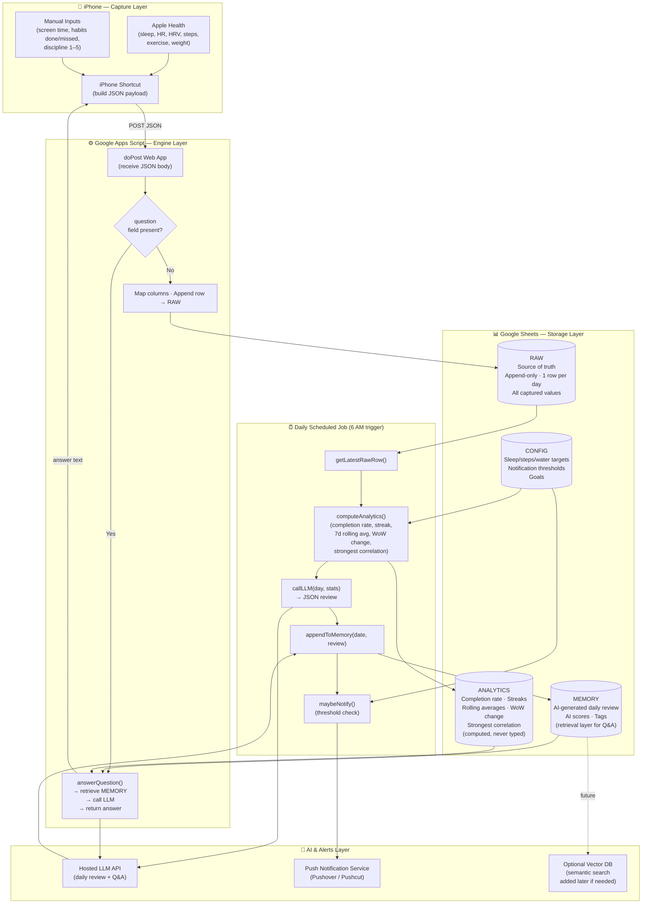

# Personal Habit Intelligence System

A free and fully automated system that captures daily habit data from an iPhone, stores it in Google Sheets, generates an AI daily review, sends a phone notification, and answers questions about past behavior on demand.

---

## Goal

Capture daily life and habit data with almost no effort, keep a clean history, compute the few metrics that actually change behavior, generate a short AI review each day, and make the whole history queryable in natural language.

---

## Architecture Overview

The iPhone captures data through a Shortcut that reads Apple Health values automatically and asks for a few manual inputs. The Shortcut sends one JSON payload per day to a Google Apps Script web app. Apps Script appends the day as a single row in a Google Sheet. A daily time trigger then computes analytics, calls a hosted language model to produce a short review, writes that review back to the Sheet, and pushes a phone notification when a value crosses a threshold. The same Apps Script web app can also answer questions sent from the phone by retrieving relevant past days and calling the language model.

---

## Architecture Diagram



---

## Components

| Component | Role |
|---|---|
| iPhone Shortcut | Reads Apple Health values automatically and prompts for manual inputs |
| Google Apps Script Web App | Engine for ingestion, analytics, AI review, and Q&A routing |
| Google Sheets | Structured storage with tabs RAW, ANALYTICS, MEMORY, and CONFIG |
| Hosted LLM API | Produces daily review JSON and answers natural-language questions |
| Push Notification Service | Pushover or Pushcut — sends threshold-based phone alerts |
| Optional Hosted Vector DB | Added later only if semantic (meaning-based) search is needed |

---

## Storage Layout

### RAW
- Source of truth
- Append-only, one row per day
- Never edited by hand
- Every captured value goes here

### ANALYTICS
- Computed from RAW using sheet formulas and Apps Script
- Holds completion rate, streaks, rolling averages, week-over-week changes, and the strongest correlation
- Nothing here is typed by the user

### MEMORY
- AI-generated daily review text, AI scores, and tags
- The layer used for retrieval when answering questions

---

## Data Model

Each day is a single flat row in RAW. Derived values such as rates, streaks, averages, and AI scores are never typed. They are computed in ANALYTICS and MEMORY. A day is valid even if only the Tier 1 fields are filled.

---

### Tier 1 — Captured from Day One

High-value and low-effort. Most come automatically from Apple Health, with one quick subjective input.

| Field | Description | Source |
|---|---|---|
| `date` | Key for every record | Derived |
| `sleep_hours` | Strongest driver of focus and mood | Apple Health |
| `bedtime` | Time sleep started; needed for bedtime consistency questions | Apple Health |
| `wake_time` | Time of waking; used with bedtime to measure sleep timing | Apple Health |
| `resting_hr` | Daily recovery signal | Apple Health |
| `hrv` | Early stress and recovery indicator | Apple Health |
| `steps` | Movement proxy | Apple Health |
| `exercise_min` | Captures workouts that steps alone miss | Apple Health |
| `weight` | Slow trend value | Apple Health |
| `screen_min` | Biggest lever for focus | Manual entry or read where possible |
| `habits_done` | Core measure of showing up (numerator) | Shortcut tap |
| `habits_total` | Core measure of showing up (denominator) | Shortcut tap |
| `habits_missed` | Short list of habit names not completed; needed to answer which habits are missed most often | Shortcut tap |
| `discipline` | One-to-five subjective anchor | One tap |
| `day_type` | Weekday or weekend; derived from date so off-days are not compared unfairly against work days | Derived |

---

### Tier 2 — Added After Two to Three Weeks of Consistency

Added once Tier 1 entry is a stable habit.

| Field | Description |
|---|---|
| `water_l` | Daily water intake |
| `mood` | One to five |
| `energy` | One to five |
| `deep_work` | One to five |
| `exercise_time` | Time of day exercise happened; used to study whether morning exercise changes focus |
| `caffeine` | Number of servings |
| `alcohol` | Number of servings |
| `biggest_win` | Short line of text |
| `biggest_blocker` | Short line of text |
| `meals_raw` | Compact meal text (see format below) |
| `tags` | Short list of words such as `travel`, `deadline`, or `sick` |

> **Targets** (sleep goal, steps goal, water goal) are not stored per day. They live once in a separate **CONFIG tab** so that questions like "did I hit my target?" can compare the day against the goal without repeating the goal in every row.

---

### Tier 3 — Optional and AI-Estimated

Not typed. The language model estimates these from meal text and other fields.

- Per-app screen breakdown
- Meal macros: calories, protein, and fiber

---

### Meal Text Format

Meals are stored as compact lines, one meal per line, with fields separated by a vertical bar in the order: meal type, time, description, serving, and estimated calories.

```
Breakfast|08:30|egg omelet with one toast|medium|250
Lunch|13:00|rice, dal, and salad|large|600
```

---

### AI-Generated Fields (stored in MEMORY, never typed)

| Field | Description |
|---|---|
| `summary_text` | Short narrative of the day |
| `wins` | Highlights from the day |
| `misses` | What fell short |
| `one_line_reality_check` | Brutally honest one-liner from the AI |
| `discipline_score` | AI-scored discipline rating |
| `health_score` | AI-scored health rating |
| `focus_score` | AI-scored focus rating |
| `estimated_calories` | Estimated from meal text |
| `protein_signal` | Protein adequacy signal from meal text |

---

## Implementation Logic

### 1. Capture on the Phone

- Create a Shortcut that reads `sleep_hours`, `bedtime`, `wake_time`, `resting_hr`, `hrv`, `steps`, `exercise_min`, and `weight` from Apple Health.
- Prompt for `screen_min`, `habits_done`, `habits_total`, the names of any missed habits, and `discipline`.
- Build a single dictionary with all Tier 1 fields and the current date.
- Send the dictionary as JSON in a POST request to the Apps Script web app URL.
- Schedule the Shortcut to run each night, or trigger it manually before bed.

### 2. Ingest into RAW

- Define a fixed list of column names in the order they appear in RAW.
- In `doPost`, parse the JSON body into an object.
- Map each column name to its value, using an empty value when a field is missing.
- Append the mapped values as one new row in RAW.
- Return a small JSON response confirming success.

### 3. Compute Analytics

- Read the newest RAW row as an object.
- Compute **completion rate** as `habits_done` divided by `habits_total`.
- Compute the **current streak** by counting consecutive days that meet a threshold.
- Compute **7-day rolling averages** for sleep, steps, screen time, and discipline.
- Compute **week-over-week change** for the same values.
- Compute the **strongest correlation** between an input and an outcome score, grouped by `day_type` so weekdays and weekends are compared fairly.
- Write all computed values into the ANALYTICS tab.

What usually happens before I lose focus?

Which app usually starts my distraction spiral?

What usually happens before a low discipline day?

Which apps do I rarely regret?

Which apps almost always end with Worth = No?

When I sleep less than 6 hours,
what app do I spend the most time on?


Steps:
Daily Status
What happened today?
Give me today's health summary.
Did I hit my movement goal?
Did I achieve mindful minutes today?
Did I take a post-lunch walk?
Did I sit too long today?
Did I move enough in the morning?
How intentional was my movement today?

Trends
Show my movement trend.
Is my movement improving?
Are my mindful minutes becoming consistent?
Is my inactivity decreasing?
How many days did I walk after lunch?
Which weekday has the most movement?
Which weekday has the least movement?

Correlations

These become incredibly valuable.

Does morning walking improve deep work?
Does a post-lunch walk improve focus?
Does mindfulness reduce screen time?
Does meditation improve sleep quality?
Does low movement predict high YouTube usage?
Do high screen-time days have fewer steps?
Does late-night YouTube reduce morning movement?
Which habit contributes most to discipline?

Recovery
What helps me recover after a bad day?
Which habit is most important after poor sleep?
Should I prioritize walking or mindfulness today?
What should I avoid today based on yesterday?

Pattern Discovery
What do my best discipline days have in common?
Which habits usually happen together?
What breaks my streaks?
What usually happens before a low-focus day?
Which small habit has the biggest impact?


### 4. Generate the AI Review

- Build a prompt that includes the day object and the computed stats.
- Ask the language model to return JSON with:
  `summary_text`, `wins`, `misses`, `one_line_reality_check`, `discipline_score`, `health_score`, `focus_score`, and `estimated_calories`.
- Call the hosted language model API from Apps Script.
- Parse the JSON response.
- Append the review into the MEMORY tab next to the date.

### 5. Send a Notification

- Decide a message only when a value crosses a threshold — for example, discipline below a minimum, a broken streak, or a new personal best.
- When there is no message, do nothing.
- When there is a message, send it through the push service so it appears on the phone.

### 6. Answer Questions on Demand

- Let `doPost` detect a `question` field in the incoming request.
- Retrieve the few most relevant past days, first by filtering on scores and tags in the Sheet.
- Build a small context from the retrieved `summary_text` values.
- Call the language model with the question and the small context.
- Return the answer for the Shortcut to display or speak.

### 7. Schedule Everything

- Create a time-based trigger that runs the daily job once each morning.
- The daily job reads the latest day, computes analytics, generates the review, and sends the notification in sequence.

---

## Implementation Examples

### Daily JSON Payload Sent from the Phone

```json
{
  "date": "2026-06-25",
  "sleep_hours": 6.4,
  "resting_hr": 58,
  "hrv": 42,
  "steps": 8200,
  "exercise_min": 30,
  "weight": 74.1,
  "screen_min": 310,
  "habits_done": 5,
  "habits_total": 7,
  "discipline": 3
}
```

### Apps Script — Receive Payload and Append Row

```javascript
const COLS = ["date","sleep_hours","resting_hr","hrv","steps","exercise_min",
  "weight","screen_min","habits_done","habits_total","discipline","day_type"];

function doPost(e) {
  const data = JSON.parse(e.postData.contents);
  if (data.question) {
    return reply(answerQuestion(data.question));
  }
  const sheet = SpreadsheetApp.getActive().getSheetByName("RAW");
  sheet.appendRow(COLS.map(c => data[c] ?? ""));
  return reply({ ok: true });
}

function reply(obj) {
  return ContentService.createTextOutput(JSON.stringify(obj))
    .setMimeType(ContentService.MimeType.JSON);
}
```

### Daily Job Wired to a Time Trigger

```javascript
function runDailyJob() {
  const day = getLatestRawRow();
  const stats = computeAnalytics(day);
  const review = callLLM(day, stats);
  appendToMemory(day.date, review);
  maybeNotify(review, stats);
}

function setupTrigger() {
  ScriptApp.newTrigger("runDailyJob").timeBased().atHour(6).everyDays(1).create();
}
```

---

## Analytics That Matter

Compute only the metrics that can change behavior and avoid numbers that add no insight.

| Metric | What it reveals |
|---|---|
| **Completion rate** | Whether you are showing up |
| **Current streak** | Momentum |
| **7-day rolling averages** | Separates a real trend from daily noise |
| **Week-over-week change** | Whether you are improving |
| **Strongest correlation** | The single most valuable output — points to the one lever worth pulling (e.g. sleep under 6 hours tends to drop discipline sharply). Uses `day_type` and `tags` so sick days and weekends do not distort the result. |

---

## Supported Queries

### Status Questions

- What happened today?
- What is my current streak?
- What is my completion rate today, this week, and this month?
- How many hours did I sleep last night compared to my average?
- How much screen time did I have today compared to my 7-day average?
- What is my latest weight and how has it changed this month?
- Did I hit my sleep, steps, and water targets today?
- How many days this month did I complete every habit?

### Trend Questions

- How was this week compared to last week?
- What is the trend in sleep, steps, hydration, and weight?
- Is my discipline trending up or down over the last thirty days?
- How consistent has my bedtime been this week?
- Which day of the week is usually my best and my worst?
- Is my screen time increasing or decreasing month over month?
- Has my resting heart rate improved over the last month?
- Is my weekly exercise time going up?

### Pattern and Correlation Questions

- Which habits do I miss most often?
- What patterns show up on low discipline days?
- Which blockers are most linked to low focus?
- Which meal patterns line up with better days?
- How does last night's sleep affect today's discipline and deep work?
- Does high screen time predict lower completion the same day or the next day?
- What is the single strongest correlation in my data right now?
- Do days with alcohol show worse sleep the next night?
- Does morning exercise change my focus for the rest of the day?

### Memory and Similar-Day Questions

- Which past days are most similar to today?
- Show me days with high discipline and low screen time.
- Find days with low sleep and poor deep work.
- Find earlier days with the same blocker I had today.
- What did I do on my best days last month?
- Have I been in a slump like this before, and what pulled me out of it?
- When did my last long streak happen and what was different then?

### Planning and Coaching Questions

- What is the one thing I should change tomorrow?
- Based on my history, how do I recover from a low-sleep day?
- Which single fix would most improve my scores?
- Set a realistic target for next week based on recent trends.
- What should I be careful about today given how this week is going?
- What is a small habit I could add that fits my current routine?

### Notification Trigger Questions

- Is my streak at risk today?
- Did any score cross a warning threshold today?
- Is today a new personal best for any metric?
- Is my screen time today far above my normal range?
- Did my sleep drop below my safe level last night?

---

## Future AI and Scalability

These additions turn the system from a fixed daily script into a scalable and dynamic assistant. They keep the same free and automated foundation, and they plug into the existing Apps Script broker without changing the core flow.

### Agent with Tools

Instead of a fixed pipeline, expose a small set of actions to the language model and let it decide which to use for each request. The model reads the question, picks the right actions, chains them, and answers. New capability means adding one more action rather than rewriting the flow.

- Define actions such as `get_day`, `get_trend`, `find_similar_days`, `set_goal`, and `send_notification`.
- Describe each action to the model so it can call them by name with arguments.
- Let the model plan, call actions, read results, and produce the final answer.
- Add new abilities over time by registering new actions only.

### Tiered Memory for Long Histories

As years of data build up, no single context can hold every day. Compress memory in layers so retrieval always stays small and fast.

- Keep daily summaries as the base layer.
- Run a weekly job that compresses seven daily summaries into one weekly memory.
- Run a monthly job that compresses weeks into a monthly memory, and a yearly job above that.
- When answering, read the layer that matches the question scope rather than every day.

### Semantic Memory with Embeddings

Add meaning-based recall so the system can find days that feel similar even when the numbers differ.

- Generate an embedding for each daily summary through a hosted embedding API.
- Store the embedding and key metadata in a free-tier vector database.
- Retrieve the closest past days for a question by similarity rather than exact filters.
- Optionally cluster the embeddings to discover natural day types on their own.

### Predictive and Proactive Coaching

Move from describing yesterday to preparing for today.

- Use recent sleep, heart rate variability, and screen trends to estimate the kind of day ahead.
- Turn the morning notification into a short, forward-looking nudge.
- Detect unusual days automatically and ask what was different so the record stays rich.

### Multimodal Capture

Reduce manual entry by letting the model read images and voice.

- Send a meal photo to a vision model to fill the meal text and estimate macros.
- Send a screen time screenshot to a vision model to extract per-app usage.
- Use phone dictation to capture the win and blocker by voice.

### Dynamic Goals and Feedback

Let the system adapt instead of using fixed rules.

- Store goals and notification thresholds in a CONFIG tab so behavior changes without editing code.
- Adjust targets gently each week based on recent performance.
- Let each daily review be rated, and use that rating to tune the tone and focus over time.

### Model Routing

Stay low-cost while getting deeper analysis when it matters.

- Use a fast and cheap model for the daily review.
- Use a stronger model only for weekly and monthly deep analysis.
- Keep the model choice in config so providers can be swapped without code changes.

---

## Build Order

```mermaid
flowchart LR
    S1["1️⃣ Create RAW tab\n+ doPost web app\n(confirm one day flows\nfrom phone to sheet)"]
    S2["2️⃣ Build iPhone Shortcut\n(capture Tier 1 fields\nand send each night)"]
    S3["3️⃣ Add analytics\n(completion rate, streaks,\nrolling averages,\nstrongest correlation)"]
    S4["4️⃣ Add daily job\n(call LLM + write\nreview into MEMORY)"]
    S5["5️⃣ Add threshold-based\nphone notifications"]
    S6["6️⃣ Add question branch\n(ask about history\nfrom the phone)"]
    S7["7️⃣ Add vector DB\n(only if meaning-based\nsearch is needed)"]

    S1 --> S2 --> S3 --> S4 --> S5 --> S6 --> S7

    style S1 fill:#1d3557,color:#fff
    style S2 fill:#1d3557,color:#fff
    style S3 fill:#1d3557,color:#fff
    style S4 fill:#457b9d,color:#fff
    style S5 fill:#457b9d,color:#fff
    style S6 fill:#a8dadc,color:#000
    style S7 fill:#e1f5fe,color:#000
```



> **Make steps 1–3 solid before adding any AI.** Consistent data is most of the value.

---

## Constraints

- The pipeline runs automatically on a daily schedule and needs no manual step once set up.
- The system uses free-tier services so the running cost stays near zero.
- The iPhone is the main capture device.
- An optional analysis notebook can be used now and then for deeper monthly study, separate from the daily flow.
