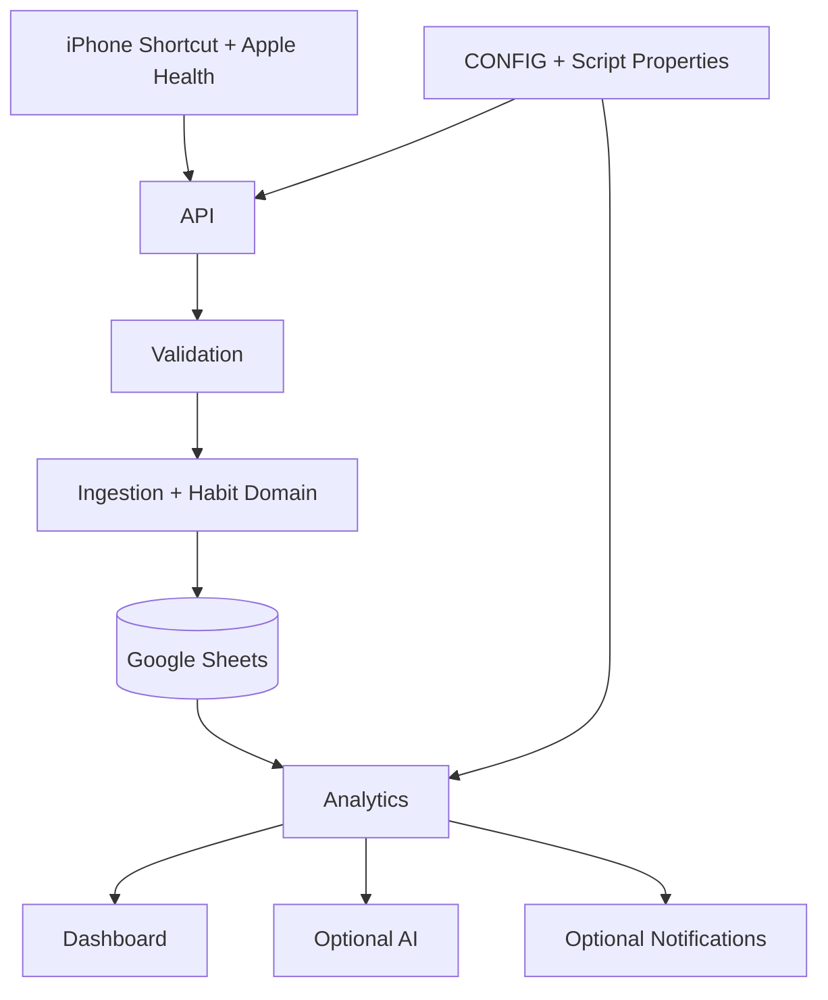

# Personal Habit Intelligence System (PHIS)

**Capture → Validate → Understand → Improve**

PHIS combines iPhone Shortcuts, Apple Health, Google Apps Script and Google Sheets to track daily measurements, individual habits and behavioural trends.

> Source code and synthetic tests are in this repository. The owner's Google Sheet, Apps Script deployment, Apple Health permissions, iPhone Shortcut and provider credentials require separate setup.

## Architecture

Apps Script loads every .gs file into one global namespace. Modules below are responsibility boundaries, not ES modules.

## Project structure

| Module | Responsibility |
|---|---|
| PHIS_Engine_v1.0.0.gs | API entry points, schema and defaults |
| PHIS_Storage_v1.0.0.gs | Workbook setup, storage, config and audit |
| PHIS_Validation_v1.0.0.gs | Date, payload and numeric validation |
| PHIS_Ingestion_v1.0.0.gs | Daily capture orchestration |
| PHIS_Habits_v1.0.0.gs | Habit definitions, schedules, events and adherence |
| PHIS_Analytics_v1.0.0.gs | Trends, streaks and correlations |
| PHIS_Dashboard_v1.0.0.gs | KPI cards and charts |
| PHIS_AI_v1.0.0.gs | Optional review and Q&A |
| PHIS_Notifications_v1.0.0.gs | Optional alerts |
| PHIS_Scheduler_v1.0.0.gs | Daily trigger |
| PHIS_Preflight_Tests_v1.0.0.gs | Synthetic Apps Script regression tests |

See docs/ARCHITECTURE.md, docs/DATA_CONTRACT.md, docs/ANALYTICS_SPEC.md, docs/SCALABILITY.md, docs/OPERATIONS.md and docs/IOS_SHORTCUT_IMPLEMENTATION.md.

## Data ownership

RAW and HABIT_LOG are canonical. HABIT_MASTER defines identity and cadence. ANALYTICS and HABIT_ANALYTICS are derived. MEMORY is optional AI interpretation. DASHBOARD is presentation only. Missing data remains unknown/not reported, not zero or missed.

## API

Every POST requires WEB_APP_SECRET in its JSON body. The endpoint fails closed until configured; GET health is public.

Supported actions: daily capture, habit_list, habit_upsert, habit_archive, daily_review and question.

## Setup

1. Create a private Google Sheet and Apps Script project.
2. Add all PHIS_*.gs files.
3. Set SPREADSHEET_ID (standalone only) and WEB_APP_SECRET in Script Properties.
4. Run setupPHISWorkbook(), phisValidateWorkbook() and PHIS_RUN_ALL_PREFLIGHT_TESTS().
5. Deploy as a Web App and test synthetic capture plus exact replay.
6. Configure Apple Health, Shortcuts, AI and notifications separately.

## Validation

Node.js 22: run `npm run check:syntax`. GitHub Actions runs the same check. Runtime spreadsheet behaviour still requires Apps Script preflight and a synthetic phone-to-Sheet integration test.

## Scalability

The first storage adapter is Google Sheets and remains subject to Apps Script quotas. See docs/SCALABILITY.md for current safeguards, monitoring and SQL/Firestore migration signals.

## Security

Keep the workbook private. Never commit API keys, secrets, real clasp configuration, spreadsheet IDs or personal exports. AI and notifications remain disabled until configured. Correlations are descriptive, not causal.
